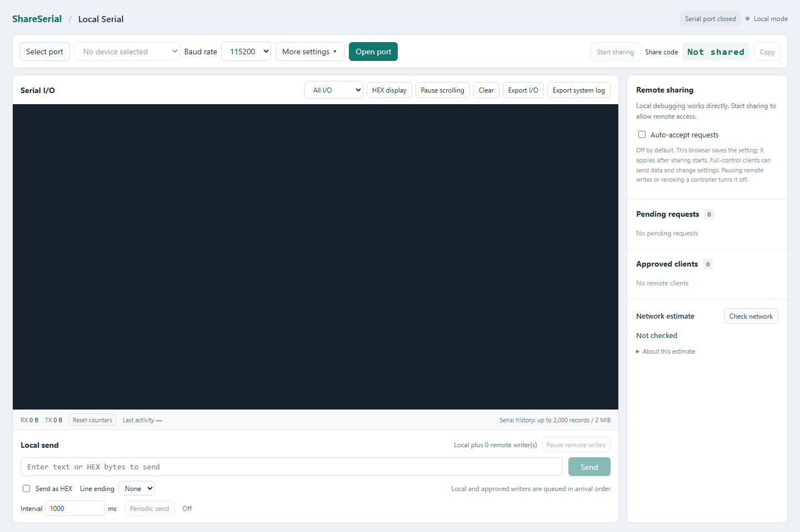

# SerialSpan

[中文](README.md)

**Self-hosted, cross-device serial debugging for embedded teams.** Keep the device connected to the Local host and let a teammate inspect its output in a browser. Local explicitly approves any remote sending or serial-parameter changes. The current application UI and Windows executable are still branded ShareSerial.



Run the Windows single-file build on the computer attached to the device, or start from source using the [deployment guide](docs/DEPLOYMENT.md). Local selects the port and starts sharing. Remote opens `/remote` and enters the share code; serial data uses the relay and attempts a WebRTC direct path when the network allows it.

**This is experimental version `0.1.0-beta.2-p2p.1`, intended for self-hosted use on trusted networks.** The five-character share code identifies a session; it is not an account or password. Do not expose the service directly to an untrusted public network. Cross-machine P2P connectivity and remote ESP32-C3 flashing still have unverified cases. See [ROADMAP.md](ROADMAP.md), [P2P scope](docs/P2P_PROBE.md) and [SECURITY.md](SECURITY.md).

## Quick start

1. Run ShareSerial on the computer connected to the serial device. Windows uses one EXE; other platforms and certificate setup are covered by the [deployment guide](docs/DEPLOYMENT.md).
2. Open Local, select the port and baud rate, and start sharing when needed.
3. On the remote computer, open `/remote` and enter the share code. Local approves the request; Remote is read-only by default and needs full-control approval to send or change serial settings.

Local requires a desktop Chromium browser with Web Serial support and trusted HTTPS. The device does not need custom firmware. Remote ESP32 flashing is experimental; verified behavior and limits are listed below.

GitHub beta release: <https://github.com/eleree/SerialSpan/releases>. If you try it, share your setup and results through the [beta feedback form](https://github.com/eleree/SerialSpan/issues/new?template=beta_feedback.yml). Do not post serial contents, share codes, or certificate details.

## Capabilities and limits

- When both pages support TX relay, a 16-entry unmatched direct-TX queue switches only that Remote's later writes to the existing authorized WSS FIFO while P2P RX stays direct. Other Remotes are unaffected. Ambiguous in-flight TX is cancelled and never replayed; older pages keep whole-link fallback.

- One Local page operates one port independently and can optionally share it with multiple Remotes. The terminal shows serial RX/TX; connection and P2P diagnostics stay in a separate buffer available through Export system log.
- Local approves each request manually or under its explicitly enabled automatic policy. Requests default to read-only; Local and multiple approved writers share one bounded serial FIFO.
- Local's automatic-accept preference is off by default and saved in that browser. It applies only while sharing is registered; pausing remote operations, revoking a controller or a resource-limit shutdown clears it.
- Remote reconnects automatically by default and stores the last share code and requested access locally. Reconnects create a fresh request and never reuse a grant; denial, approval timeout, resource limits or manual disconnect stop retries. Local approval is still required unless automatic acceptance was explicitly enabled.
- Local can approve, downgrade to read-only, deny or revoke. Requests expire after 60 seconds; each Local allows 8 pending requests and 16 approved connections.
- Local sets initial serial parameters. An approved full-control Remote can request baud rate, 7/8 data bits, 1/2 stop bits, parity and none/hardware flow changes; Local reopens the device and confirms the actual result. Read-only Remotes cannot change settings.
- Remote supports text/HEX sending and display, a real CR suffix, AT presets and RX export.
- Local and Remote support periodic sends with fixed input bytes and line endings, defaulting to 1000 ms within 20–86400000 ms. Each submission completes before the next delay; stopping, failure or loss of permission/serial availability never resumes the job automatically. RX/TX byte counters can be reset without clearing history or receive cursors. Remote TX counts successful submissions, not device execution acknowledgements.
- Each serial P2P attempt allows up to 45 seconds while WSS remains usable; explicit native failure falls back earlier. When both endpoints support retries, network failures trigger fresh attempts after 5/10/20 seconds, bounded to four attempts within three minutes. Serial commands are never replayed and old-round messages cannot revive transport. Older peers retain one-attempt behavior. A `srflx` candidate proves mapped-address discovery, not peer reachability.
- Live P2P RX and historical WSS backfill can run together using one ordered, deduplicated cursor. Modern receivers avoid a second server-side live payload queue during backfill; bounded-buffer overflow requests another Local cache window, and expired cache ranges are reported as gaps. TX commands are never replayed automatically.
- Fallback preserves DTLS/SCTP and channel states, application failure source, assessment activity/buffering and bounded ICE counters. Native errors expose only a typed category and SCTP number. The server logs at most one redacted snapshot per endpoint and round without replacing the first cause; clearing page logs does not delete server records. Capture is limited to 200 ms while WSS is immediately usable. Revocation/disconnection closes immediately, retired reports are dropped, and missing statistics are marked unavailable.
- ESP32 flashing accepts BIN files and explicit addresses without a JSON manifest. Eight independent file rows, SPI/device settings, start/stop, progress and logs use the same controls and colors as Local/Remote. File, address or setting changes require fresh validation and confirmation; stopping disconnects the current Remote authorization.
- The flasher library loads on demand when connecting to detect a chip, before reserving the serial port. Preparation supports retry and stop. Progress weights compressed transfer fractions by BIN size; 100% requires successful reset, original baud restoration and lock release.
- Remote also has an experimental ESP32-C3/S3 serial flashing toolbox. Remote serial and ESP32 flashing share one document, WebSocket and authorization; switching tools does not reload the page or request another grant. It uses the share code and an approved full-control connection to flash the serial port already open in Local. The Remote browser reads BIN files, validates their write ranges and computes file digests; firmware bytes are relayed as serial data over WebSocket and are not stored as files on the server. A flash session reserves serial writes while RX remains available. An ESP32-S3 with 8 MB flash on COM7 passed chip detection, all three Hello World image writes, lock release and boot output over the local relay, a controlled slow link and the public preview relay. Subsequent native read-back verification matched all three images. ESP32-C3 and remote interrupted-write recovery remain unverified. Compressed writes use 2 KiB blocks, packet replies wait at least 30 seconds, and a session expires after 90 seconds without renewal. New sends stop if the browser backlog exceeds 64 KiB. Network or signal timeouts are reported; reconnecting requires fresh approval. See [ESP32 flashing](docs/ESP32_FLASHING.md).
- Local and Remote terminals show only serial RX/TX. Connection, authorization, P2P and reconnect events stay in a separate buffer with an Export system log action. Local retains up to 500 system events and 2000 serial records/2 MiB; Remote RX export excludes system events.
- The interface automatically selects Chinese or English from the browser's preferred languages.
- Local re-registers after network reconnection. Remotes must request approval again. Revocation drops queued writes that have not executed; commands are never replayed.
- During a network interruption, Local keeps up to 1 MiB, 8192 frames or 30 seconds of device RX in memory. A previously connected Remote can resume by sequence after requesting and receiving approval again. Expired or evicted data is reported as a gap; new Remotes start with live data. The cache is cleared when sharing stops, the port closes or Local reloads. It is not written to server storage, and TX commands are never replayed.
- No account authentication, physical device write ACK or server-side data storage. Connection IDs identify sessions; they are not passwords.
- Anonymous resource limits cover connection capacity, per-IP attempts/requests, messages, application bytes, daily relay/sample allowance and queued bytes. Limits stop sharing while preserving the Local serial port; Remote connects on demand and releases idle transports. See [resource limits](docs/RESOURCE_LIMITS.md) for configuration, proxy trust and accounting boundaries.
- Serial payloads are limited to 16 KiB per message. Local splits larger reads; Remote rejects oversized sends.
- The server rejects malformed Base64 and empty decoded payloads, including CR/LF-only input.
- Local/Remote assess the current route on demand: the page's HTTP server downlink while relayed, or bidirectional P2P effective throughput and round-trip time while direct. When TX uses WSS but RX remains direct, the reference follows the server relay route. Local can select among approved peers. Route or authorization changes invalidate old results. Assessment never starts automatically, changes baud settings, writes to the serial port or contributes to RX/TX counters. Estimates do not replace real-device validation; see [diagnostics](docs/DIAGNOSTICS.md).

## Architecture

```text
Serial device <-> Local browser <-> Go relay <-> Remote browser
                Web Serial       WebSocket    WebSocket
                      +----- WebRTC serial bytes -----+
```

The Remote ESP32 tool uses the same serial data path: the board stays attached to the Local host, and the relay forwards authorized firmware bytes without storing them as files.

Go, Gin and gorilla/websocket serve HTTPS and relay JSON. The frontend uses plain HTML/CSS/JavaScript, Base64 for relayed bytes and bounded binary frames for direct bytes. Approval, signaling and per-command digest permits always use the server. Session state is in memory.

One Hub event loop owns registration, subscriptions and client cleanup. Each socket has one reader and one writer. Static assets are embedded in the executable.

## Quick start

Windows users receive the EXE produced directly by `go build`, without repackaging. Web resources and notices are embedded at compile time. Copy and double-click it to configure the LAN address, port and unique HTTPS certificate. User data stays in `%LOCALAPPDATA%\ShareSerial`; developer tools, PowerShell and sidecar resources are not required. Linux/macOS use archives. See [deployment](docs/DEPLOYMENT.md) for instructions and validation limits.

[VERSION](VERSION) is the product version source. Download filenames, CLI/startup output and Windows release file properties agree; this experiment uses `0.1.0-beta.2-p2p.1`.

### Developing from source

Use Go 1.25+. Local needs a browser with Web Serial in a trusted HTTPS context; Remote only needs WebSocket support. ESP32 flashing additionally requires Local to support serial configuration and DTR/RTS control signals.

```sh
git clone https://github.com/eleree/SerialSpan.git
cd SerialSpan
go mod download
go run ./cmd/devcert
go run . -addr 127.0.0.1:12345
```

Open https://127.0.0.1:12345 or https://localhost:12345. Development certificates are unique to your environment, valid for 30 days and stored in the ignored .local/certs directory. Existing files are never overwritten. Trust your own certificate in your development environment or provide an existing trusted certificate; bypassing a warning does not guarantee Web Serial availability. See the [Web Serial documentation](https://developer.mozilla.org/en-US/docs/Web/API/Web_Serial_API).

### LAN access

The default listener is loopback only. Other computers require an explicit listen address and a certificate covering the real host/IP. Replace the example IP below with your server's address:

```sh
go run ./cmd/devcert -out .local/lan-certs -hosts localhost,127.0.0.1,192.168.1.10
go run . -addr 0.0.0.0:12345 -cert .local/lan-certs/cert.pem -key .local/lan-certs/key.pem
```

Development browsers must trust the generated certificate. Use trusted HTTPS certificates for actual deployments. Basic resource budgets are implemented; personnel authentication is not. See SECURITY.md for deployment boundaries.

### Using the device

1. Open /local on the device's computer, select the port, set its parameters and open it. Local can send/receive directly without a relay connection or a Remote.
2. Click Start sharing when remote collaboration is needed. After registration is acknowledged, share the displayed five-character share code with a trusted user.
3. Open /remote on the same server, enter the ID and request read-only or control access.
4. Local approves manually by default. Optional automatic acceptance can approve multiple readers and writers; the server enforces ownership, expiry and limits.
5. Local and approved Remote writers enqueue through the same FIFO. Pause remote operations retains subscriptions and RX, disables automatic acceptance, invalidates old queued Remote commands and blocks remote configuration. Resume requires fresh submissions and never replays the old queue.
6. Local supports text/HEX, none/CR/LF/CRLF endings, RX/TX filters, scrolling pause and serial export. Serial history is capped at 2000 records and 2 MiB of raw bytes; a separate system buffer retains up to 500 recent events for on-demand export. Pausing scrolling continues receiving, and clearing serial history preserves cumulative counters and the system log.
7. Stop sharing leaves the physical port open. Remote retries after disconnection with bounded backoff and submits a new access request; grants never survive a reconnect. Local's automatic-accept preference is stored in that browser and applies after a later share registration. Pausing, revoking a controller or a resource-limit shutdown clears it.
8. A full-control Remote edits parameters in the sidebar and clicks Apply. Only one change can run; pending writes cause a busy rejection. New sends stop during configuration and all approved peers receive the confirmed settings. Failed changes attempt rollback; uncertain state or a 30-second timeout stops sharing. Reopening may discard device buffers or reset the device depending on the driver and hardware.
9. For ESP32 flashing, enter the share code in the Remote top bar, request full control and wait for Local approval. Open **ESP32 Flashing** in the left navigation. Detection and flashing reserve serial writes; verify the chip, image offsets and hashes before starting. The tool attempts to restore Local's original baud rate afterward. See [ESP32 flashing](docs/ESP32_FLASHING.md) for scope and hardware acceptance status.

Local TX logs include source and enqueue order; Remote TX means submitted. The queue does not associate device responses with commands or provide transaction isolation. The protocol v3 configuration extension requires Local to advertise configProtocol=1; older Local pages cannot be configured remotely. Update the server and both pages, then request fresh approval.

## Build and configuration

```sh
go build -o .local/shareserial .
```

On Windows, use go build -o .local/shareserial.exe .

| Flag | Default | Purpose |
|---|---|---|
| -addr | 127.0.0.1:12345 | HTTPS listen address |
| -cert | .local/certs/cert.pem | TLS certificate |
| -key | .local/certs/key.pem | TLS private key |

## Maintenance

- [PROTOCOL.md](PROTOCOL.md): messages, errors, lifecycle and compatibility.
- [Access control](docs/ACCESS_CONTROL.md): approval, shared FIFO, pause/resume and revocation (Chinese).
- [CONTRIBUTING.md](CONTRIBUTING.md): checks, contribution and release requirements.
- [AGENTS.md](AGENTS.md): human and AI maintenance constraints.
- [ROADMAP.md](ROADMAP.md): baseline, hardware acceptance and planned work.
- [CHANGELOG.md](CHANGELOG.md): behavior and compatibility changes.
- [Maintenance baseline](docs/MAINTENANCE_BASELINE.md): audit decisions and verification results (Chinese).
- [Mutation testing](docs/MUTATION_TESTING.md): isolated, contract-focused mutation checks and reporting rules (Chinese).

```sh
go vet ./...
go test ./...
go test -race ./...
node --test tests/serial-data.test.cjs tests/browser.test.cjs tests/access.test.cjs
node --test tests/network-reference.test.cjs
node --test tests/mutation-runner.test.cjs
node --test tests/i18n.test.cjs
node scripts/mutation-test.cjs
```

Node.js 24 is only used for tests; no npm packages are needed. Windows race checks need a C compiler, or use Linux/WSL. GitHub Actions covers Linux, Windows and macOS; the Gitee mirror does not run GitHub workflows. Simulated tests do not replace real browser and hardware validation.

## Connection diagnostics

Server logs correlate socket lifecycle, transport timeouts, queue overflow and Local ID conflicts using a process-local connection number. They omit serial payloads and peer-supplied close text. Local shows reconnect and ID-change reasons in its last 500 log lines. A reconnect first retries the original ID; an occupied ID causes a new random ID, with up to five retries. See [diagnostics](docs/DIAGNOSTICS.md) for interpretation and limitations.

## License

[MIT](LICENSE). Do not commit certificates, keys or binaries. Historical development keys are public and must be replaced before deployment; see SECURITY.md.
