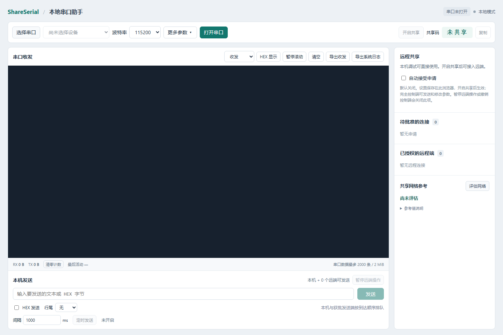

# SerialSpan

[English](README.en.md)

**面向嵌入式团队的自托管跨设备串口调试工具。** 设备留在连接它的 Local 主机，远端通过浏览器查看输出；Local 明确批准后，远端才可发送数据或修改串口参数。当前应用界面和 Windows 程序仍使用 ShareSerial 名称。



连接设备的电脑运行 Windows 单文件版，或按[部署说明](docs/DEPLOYMENT.md)从源码启动。Local 选择串口并开启共享，Remote 打开 `/remote` 输入共享码；设备数据经中转传输，网络允许时也会尝试 WebRTC 直连。

**当前为 `0.1.0-beta.2-p2p.1` 实验版，面向受信任网络中的自托管调试。** 五位共享码只是会话定位符，不是账号或密码；不要把服务直接暴露到不受信任的公网。跨机器 P2P 直连和 ESP32-C3 远程烧录仍有未验证范围，见 [ROADMAP.md](ROADMAP.md)、[P2P 范围](docs/P2P_PROBE.md)和[安全边界](SECURITY.md)。

## 快速开始

1. 在连接串口设备的电脑运行 ShareSerial。Windows 使用单文件 EXE；其他平台和证书配置见[部署说明](docs/DEPLOYMENT.md)。
2. 打开 Local 页面，选择串口和波特率，按需开启共享。
3. 远端浏览器打开 `/remote` 并输入共享码。Local 批准后，Remote 默认只读；获批完全控制后才可发送或修改串口参数。

Local 需要支持 Web Serial 的桌面 Chromium 浏览器和可信 HTTPS。该项目不要求设备更换固件；Remote ESP32 烧录为实验功能。已验证行为与限制见下方。

GitHub Beta 发布页：<https://github.com/eleree/SerialSpan/releases>。想参加试用可看[招募说明](https://github.com/eleree/SerialSpan/issues/1)，试用后请通过 [Beta 反馈表单](https://github.com/eleree/SerialSpan/issues/new?template=beta_feedback.yml) 分享环境和实际结果；请勿公开串口内容、共享码或证书信息。

## 功能与边界

- 两端都支持时，直连 TX 待配对队列达到 16 项会只把该 Remote 后续写入切到服务器 FIFO，P2P RX 保持直连；其他 Remote 不受影响。切换时未完成 TX 结果未知且不会自动重放。旧页面继续使用整条连接回退。

- 一个 Local 页面独立操作一个串口，支持本机收发；开启共享后多个 Remote 可以接收设备数据。终端只显示串口收发，连接与 P2P 诊断保存在独立缓冲，可按需导出系统日志。
- 每次连接由 Local 手动或按显式开启的自动接受策略批准。默认只读，多个可发送端与本机共用有界 FIFO，逐条写入。
- Local 的自动接受默认关闭；勾选后保存在当前浏览器，只在共享已注册时生效。暂停远端操作、撤销控制端或资源限制停用共享会清除该偏好。
- Remote 默认启用断线自动重连，并在本地浏览器保存最近的共享码和申请权限。重连会重新申请，不继承旧授权；拒绝、审批超时、资源限制或手动断开会停止重试。Local 仍须重新批准，除非已显式开启自动接受。
- Local 可批准、降为只读、拒绝或撤销；申请 60 秒过期，每个 Local 最多 8 个待批准申请、16 个已授权连接。
- Local 设置初始串口参数；获“完全控制”的 Remote 可修改波特率、7/8 数据位、1/2 停止位、校验和 none/hardware 流控，由 Local 重开设备并确认结果，只读端不可修改。
- Remote 支持文本/HEX 发送与显示、追加 CR、AT 预设命令和接收记录导出。
- Local/Remote 支持定时发送：固定开始时的内容与行尾，默认 1000 ms，范围 20–86400000 ms；一次提交完成后再等待下一周期。停止、发送失败或权限/串口状态失效后不自动恢复。两端提供 RX/TX 字节计数及独立清零，清零不清日志或接收游标；Remote TX 表示成功提交，不代表设备执行确认。
- 串口 P2P 每轮最多 45 秒，中转期间可正常收发；浏览器明确失败时提前回退。两端均支持重试时，网络类失败后等待 5/10/20 秒发起新一轮，最多 4 轮、总窗口 3 分钟；不重发串口命令，旧轮次消息不能恢复连接。旧端保持单轮行为。拿到 `srflx` 仅表示获取了公网映射，不代表对端地址已可达。
- P2P 实时 RX 与 WSS 历史补传可同时进行，按同一序号排序去重。现代接收端补传期间不在服务器另排实时数据队列；暂存不足时继续从 Local 有界缓存分段补收，缓存过期明确提示缺口，TX 不自动重发。
- 回退诊断保留 DTLS/SCTP、通道状态、应用回退入口、测速状态/发送积压及有界 ICE 计数，原生错误只取类型与 SCTP 数字码。服务器每端每轮最多记录一份脱敏快照，首个回退原因不被另一端覆盖；页面清日志不删除服务器记录。采集最多 200 ms，中转立即可用，撤销/断线立即关闭直连，旧轮次报告丢弃；未取得统计会明确标注。
- ESP32 烧录只需选择 BIN 并填写地址，无需 JSON 清单。保留 8 行独立文件选择、SPI 参数和设备信息，以及开始/停止、进度和日志；界面与 Local/Remote 使用一致的配色与控件。修改文件、地址或参数后必须重新校验并确认，停止会断开当前远端授权。
- 烧录库在点击“连接并检测”时按需加载，准备完成前不占用串口；失败可重试，准备期间可停止。进度按各 BIN 大小加权计算压缩传输比例，设备复位、原波特率恢复和串口锁释放成功后才显示 100%。
- Remote 另有实验性的 ESP32-C3/S3 串口烧录工具箱：通过共享码和获批的完全控制连接，烧写 Local 已打开的 ESP32 串口。Remote 串口与 ESP32 烧录共用一个页面和连接授权；切换工具不会整页重载、重开 WebSocket 或重新申请批准。Remote 浏览器读取 BIN、校验写入范围并计算文件摘要，镜像字节经 WebSocket 作为串口数据转发，不会作为文件存到服务器。烧录会话独占写入，Local 和其他 Remote 暂时不能发送，接收保持可用。COM7 的 ESP32-S3（8 MB）已通过本机中转、受控慢网和公网预览中转的检测、Hello World 三镜像完整写入与启动输出验证，随后本机回读校验均通过。ESP32-C3 与远程中断恢复仍待验收。压缩写入采用 2 KiB 数据块，协议包回复至少等待 30 秒，会话 90 秒未续期释放；浏览器发送积压超过 64 KiB 时停止新发送。网络或控制信号超时会报告错误，重连后需重新授权。见 [ESP32 烧录说明](docs/ESP32_FLASHING.md)。
- Local/Remote 终端只显示 RX/TX；连接、授权、P2P 和重连事件不混入串口记录，另有“导出系统日志”按钮。Local 系统日志保留最多 500 条，串口数据保留最多 2000 条/2 MiB；Remote 的 RX 导出不包含系统事件。
- 页面根据浏览器首选语言自动切换中文或英语。
- Local 的网络连接恢复后重新注册串口；Remote 必须重新申请并获批。撤销权限会丢弃尚未执行的写队列，不重放旧命令。
- 弱网中断时，Local 在内存中保留最多 1 MiB、8192 帧、30 秒的设备 RX。此前连接的 Remote 重新申请并获批后可按序号补收；缓存过期或溢出会显示缺口，新 Remote 从实时数据开始。停止共享、关闭串口或刷新 Local 会清除缓存；数据不会写入服务器磁盘，TX 命令不补发。
- 没有账户认证、物理设备写入 ACK 或服务端数据留存。五位 ID 是会话定位符，不是密码。
- 每条串口数据最多 16 KiB；Local 自动分片，Remote 超过限制会提示错误。
- 服务端拒绝非法 Base64 和解码为空字节的数据，包括仅有 CR/LF 的输入。
- Local/Remote 的“评估网络”按当前路径选择：未直连时测本页到服务器的下行和 HTTP 往返，已直连时测所选对端的 P2P 双向有效速率和往返；TX 已切到 WSS、RX 仍直连时按服务器中转路径参考。Local 有多个已授权端时可选择对象；路径或授权变化后旧结果失效。不自动测速或修改波特率，探测不进入串口、不计入 RX/TX；参考值不能代替真实设备验证。说明见 [连接诊断](docs/DIAGNOSTICS.md)。
- 无需注册账号；共享连接、申请、消息、应用流量和发送队列均有资源上限，包含跨连接/IP 预算及每日中继额度。超限停止共享并保留本机串口，配置及计数边界见 [资源限制](docs/RESOURCE_LIMITS.md)。Remote 按需连接，离线或撤销后释放连接。

## 架构

```text
串口设备 ←→ Local 浏览器 ←→ Go 转发服务 ←→ Remote 浏览器
           Web Serial       WebSocket        WebSocket
                 └──────── WebRTC 直连字节 ─────────┘
```

Remote ESP32 工具复用上面的串口数据链路：Local 主机连接板卡，Remote 上传的固件字节由服务按授权转发，不作为文件保存。

Go + Gin 提供 HTTPS 与页面，gorilla/websocket 传输 JSON 消息；原生 JavaScript 操作串口和界面。中转字节使用 Base64，直连使用有界二进制帧；授权、协商和 TX 摘要许可始终经服务器。连接状态只在服务内存中保存。

Hub 用一个事件循环管理连接、注册和订阅；每个 WebSocket 有一个读取协程和一个写入协程。静态资源嵌入编译产物，运行二进制不需要额外 static 目录。

## 快速开始

Windows 交付就是 `go build` 直接生成的 EXE，网页和许可证在编译时内嵌，不做二次封装。复制到目标电脑后双击，首次配置局域网 IP、端口和专属证书；配置保存在 `%LOCALAPPDATA%\ShareSerial`，无需开发环境、PowerShell 或旁置资源文件。Linux/macOS 提供归档，详细步骤和验收边界见 [发布包部署](docs/DEPLOYMENT.md)。

版本由 [VERSION](VERSION) 统一维护。Windows 下载文件带完整版本号，`-version`、启动提示和发布文件属性保持一致；本实验分支为 `0.1.0-beta.2-p2p.1`。

### 从源码开发

需要 Go 1.25+。Local 浏览器须支持 Web Serial 并处于可信 HTTPS 环境；Remote 浏览器只需要支持 WebSocket。使用 ESP32 工具时，Local 还需支持串口参数修改与 DTR/RTS 控制信号。

```sh
git clone https://github.com/eleree/SerialSpan.git
cd SerialSpan
go mod download
go run ./cmd/devcert
go run . -addr 127.0.0.1:12345
```

服务器默认地址为 https://127.0.0.1:12345，也可访问 https://localhost:12345。证书生成在被 Git 忽略的 .local/certs，30 天有效，拒绝覆盖现有文件。在开发环境中信任自己生成的证书，或使用已有可信证书；浏览器仅忽略证书警告不保证 Web Serial 可用。浏览器支持边界见 [Web Serial 文档](https://developer.mozilla.org/en-US/docs/Web/API/Web_Serial_API)。

### 局域网共享

默认仅绑定回环地址。让其他电脑访问时，显式指定监听地址和覆盖实际域名/IP 的证书。下面的 192.168.1.10 是示例，应替换成服务器的局域网 IP：

```sh
go run ./cmd/devcert -out .local/lan-certs -hosts localhost,127.0.0.1,192.168.1.10
go run . -addr 0.0.0.0:12345 -cert .local/lan-certs/cert.pem -key .local/lan-certs/key.pem
```

开发证书仅供开发使用，访问设备的浏览器需信任它。实际部署使用可信 HTTPS 证书。当前提供基础资源限制，没有人员身份认证；公网配置和边界见 SECURITY.md。

### 使用步骤

1. 设备所在电脑访问 /local，点击“选择串口”，设置参数，再点击“打开串口”。本机可直接发送、接收，不需要远端或共享服务器连接。
2. 需要远程协作时点击“开启共享”。服务器确认注册后显示五位共享码，将其交给受信任的使用者。
3. 使用者访问同一服务器的 /remote，输入 ID，选择“只读”或“完全控制”并申请连接。
4. Local 默认手动核对远程编号后批准；可开启“自动接受申请”，自动批准多个只读和完全控制端。该偏好保存在本地浏览器；暂停远端操作、撤销控制端或资源限制停用共享时会清除。
5. 正常收发时，本机与所有获批发送端统一排队。“暂停远端操作”保留远端连接和接收，关闭自动接受并作废旧远端队列，同时禁止远程参数修改；恢复后需要重新提交命令。
6. Local 支持文本/HEX、无/CR/LF/CRLF 行尾、收发筛选与导出。串口历史最多 2000 条且原始字节最多 2 MiB；系统日志在单独的有界缓冲中保留最近最多 500 条，可按需导出。暂停滚动仍继续接收；清空串口历史不清零累计字节计数，也不清空系统日志。
7. “停止共享”解除远端订阅，本机串口继续打开。Remote 断线后会按退避间隔自动重连并重新申请权限；旧授权不会恢复，Local 仍需批准。Local 的自动接受偏好保存在本地浏览器，并在后续共享注册时生效；暂停、撤销控制端或资源限制会清除它。首次访问仍需加载网页资源。
8. 完全控制端在右侧修改参数后点击“应用参数”。同一时间只处理一个修改，尚有写入时拒绝并提示稍后重试；修改期间停止新发送，完成后同步给所有已授权端。失败会尝试恢复原参数，无法确认或超过 30 秒则停止共享。重开可能丢弃设备缓冲或触发设备复位，真实行为取决于设备和驱动。
9. 使用 ESP32 工具时，在 Remote 顶部输入共享码并申请完全控制，获批后打开左侧“ESP32 烧录”。检测与烧录会独占串口写入；确认目标芯片、镜像地址和哈希后再开始。会话结束后恢复 Local 原波特率；支持范围和硬件验收状态见 [ESP32 烧录说明](docs/ESP32_FLASHING.md)。

Local TX 日志包含入队序号和来源，Remote TX 表示已提交；写队列不提供设备应答归属或事务隔离。协议 v3 的参数修改扩展由 Local 显式声明 configProtocol=1；旧 Local 不支持远程配置。更新服务端与两侧页面后重新申请权限。

## 构建与配置

```sh
go build -o .local/shareserial .
```

Windows 可使用 go build -o .local/shareserial.exe .。命令行参数：

| 参数 | 默认值 | 用途 |
|---|---|---|
| -addr | 127.0.0.1:12345 | HTTPS 监听地址 |
| -cert | .local/certs/cert.pem | TLS 证书 |
| -key | .local/certs/key.pem | TLS 私钥 |

## 开发与维护

- [发布包部署](docs/DEPLOYMENT.md)：Windows 局域网交付、其他平台、升级和 GitHub 发布流程。
- [连接诊断](docs/DIAGNOSTICS.md)：服务器断线/超时日志、Local 自动重连及 ID 变化排查。
- [PROTOCOL.md](PROTOCOL.md)：消息、错误码、连接生命周期和兼容性。
- [授权设计](docs/ACCESS_CONTROL.md)：申请、多端发送队列、暂停、撤销与边界。
- [CONTRIBUTING.md](CONTRIBUTING.md)：开发环境、检查命令、贡献和发布要求。
- [AGENTS.md](AGENTS.md)：人工与 AI 的维护约束。
- [ROADMAP.md](ROADMAP.md)：已实现基线、实际硬件验收和后续工作。
- [CHANGELOG.md](CHANGELOG.md)：行为变更与兼容性影响。
- [维护基线记录](docs/MAINTENANCE_BASELINE.md)：原始缺陷、处理决定与本轮验证证据。
- [变异测试](docs/MUTATION_TESTING.md)：验证测试能否发现指定错误，包含隔离执行和报告规则。

```sh
go vet ./...
go test ./...
go test -race ./...
node --test tests/serial-data.test.cjs tests/browser.test.cjs tests/access.test.cjs
node --test tests/network-reference.test.cjs
node --test tests/mutation-runner.test.cjs
node --test tests/i18n.test.cjs
node scripts/mutation-test.cjs
```

Node.js 24 仅用于测试，不需要 npm 依赖。race 在 Windows 需要 C 编译器，也可在 Linux/WSL 运行。GitHub Actions 覆盖三个桌面系统；Gitee 镜像不会执行 GitHub workflow。模拟测试不代替实际浏览器和串口设备联调。

## 许可证

[MIT](LICENSE)。不提交证书、私钥或编译产物。旧历史中包含的开发私钥已视为公开，必须换新后再部署，详见 SECURITY.md。
